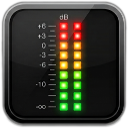

<p align="center">
  
</p>

<h1 align="center">VU LED Meter</h1>

<p align="center">
  Medidor de nível de áudio (L/R) em LEDs, para Windows — lê a <strong>saída padrão</strong> via WASAPI loopback.
</p>

<p align="center">
  
  
  
  
  
</p>

---

Um VU meter compacto e nativo para Windows: barras de LEDs para os canais
esquerdo e direito, captura do áudio que está tocando no dispositivo de saída
padrão, pico com _hold_, transparência do fundo, modo vertical e ícone na
bandeja. É um único `.exe` portátil, escrito em C++ puro (Win32/GDI/WASAPI),
sem instalador e sem bibliotecas externas.

> **Importante:** o WASAPI loopback só entrega dados quando há áudio sendo
> reproduzido. Com silêncio (ou nada tocando), as barras ficam zeradas — isso é
> o comportamento esperado, não um defeito.

## Índice

- [Recursos](#recursos)
- [Download e execução](#download-e-execução)
- [Como usar](#como-usar)
- [Janela Opções](#janela-opções)
- [Preferências (VULed.ini)](#preferências-vuledini)
- [Como compilar](#como-compilar)
- [Estrutura do projeto](#estrutura-do-projeto)
- [Detalhes técnicos](#detalhes-técnicos)
- [Solução de problemas](#solução-de-problemas)
- [Versionamento](#versionamento)
- [Créditos e licença](#créditos-e-licença)

## Recursos

- **Captura da saída padrão** com WASAPI loopback (o que o computador está
  tocando), em vez de microfone/entrada.
- **26 LEDs por canal**, escala de **−60 dB a 0 dB**, ataque instantâneo e
  decaimento suave (estilo VU clássico).
- **Pico com hold**: o LED da posição do pico fica aceso por ~0,7 s e depois
  desce acompanhando o nível.
- **Horizontal ou vertical**, com presets de tamanho de **25% a 400%**.
- **Esquema de cores simples** (cor única configurável) ou **por faixas**
  (verde → amarelo → vermelho).
- **Transparência do fundo** de 0% a 100%, ajustável em tempo real. LEDs, texto
  e pico permanecem opacos.
- **Sempre visível** (topmost) e **Iniciar com o Windows** (opcional).
- **Ícone na bandeja** e instância única.
- **Preferências persistentes** em `VULed.ini`, ao lado do executável.
- **Sem dependências**: um `.exe` estático de ~820 KB, apenas APIs do Windows.

Prévia do layout horizontal (esquema de faixas):

```text
┌──────────────────────────────────────────────┐
│ L  ▮▮▮▮▮▮▮▮▮▮▮▮▮▮▮▮▮▮▮▮▮▮▮▯▯▯              │
│ R  ▮▮▮▮▮▮▮▮▮▮▮▮▮▮▮▮▮▮▮▮▮▮▮▮▮▯              │
└──────────────────────────────────────────────┘
```

## Download e execução

1. Baixe `output/VULed.exe` deste repositório.
2. Coloque em uma pasta com permissão de escrita (por exemplo,
   `C:\Users\<você>\VULed\`) — o app grava `VULed.ini` ao lado do executável.
3. Execute. Na primeira vez o Windows SmartScreen pode avisar que o arquivo é
   de um desenvolvedor desconhecido (o `.exe` não é assinado digitalmente):
   clique em **Mais informações → Executar assim mesmo**.

Requisitos: **Windows 10 ou 11, 64 bits**. Não é necessário instalar runtime,
Visual C++ ou qualquer outra coisa.

## Como usar

| Ação | Resultado |
| --- | --- |
| Clique direito na janela | Abre o menu: `Opções...`, `Tamanho:`, `Sobre...`, `Sair` |
| Clique esquerdo no ícone da bandeja | Abre o mesmo menu |
| Duplo clique na janela | Mostra/oculta a barra de título |
| Arrastar a janela sem barra de título | Move a janela (o app faz o arrasto manual) |
| `Alt+F4` | Fecha o app (funciona também sem moldura) |

O menu **Tamanho:** aplica presets de escala (25%, 50%, 75%, 100%, 125%, 150%,
200%, 300% e 400%) mantendo o canto superior esquerdo. A janela também pode ser
redimensionada livremente pelo canto, com um tamanho mínimo dinâmico.

Abrir o app de novo não cria uma segunda janela: a instância existente é
trazida para frente. O ícone da bandeja é restaurado automaticamente se o
Explorer reiniciar. No Windows 11, o ícone novo pode aparecer em "mostrar
ícones ocultos" — use as configurações da barra de tarefas para fixá-lo.

## Janela Opções

Acesse por **clique direito → Opções...**.

| Controle | Descrição |
| --- | --- |
| **Exibir barra de título** | Alterna a moldura do sistema. Fica desabilitado enquanto houver transparência (os dois modos não coexistem). |
| **Alternar para Vertical/Horizontal** | Inverte o layout e troca largura ↔ altura para preservar a área do medidor. |
| **Exibir pico** | Liga/desliga o LED de pico com hold. |
| **Sempre visível** | Mantém a janela acima das demais (ligado por padrão). |
| **Iniciar com o Windows** | Cria/remove o valor `VULedMeter` em `HKCU\Software\Microsoft\Windows\CurrentVersion\Run`. |
| **Esquema de cores** | `Simples` usa uma cor única; `Verde/Amarelo/Vermelho` colore por posição (amarelo a partir de 70%, vermelho a partir de 85%). |
| **Escolher cor do LED...** | Abre o seletor de cores do Windows (disponível no esquema simples). |
| **Transparência do fundo** | Slider vertical de 0% (embaixo) a 100% (topo), aplicado em tempo real. Só o fundo fica transparente. |
| **Salvar** | Grava as preferências em `VULed.ini`. |

As preferências também são salvas automaticamente ao fechar o app e em algumas
ações imediatas (alternar a barra de título, soltar o slider de transparência e
marcar/desmarcar "Iniciar com o Windows").

> **Transparência e barra de título:** com transparência acima de 0% a janela
> passa a ser uma janela em camadas (`WS_EX_LAYERED` + `UpdateLayeredWindow`) e
> não desenha a moldura do sistema. Se você pedir a barra de título (pelo menu
> Opções ou com duplo clique), a transparência é desligada para que a moldura
> volte. Religá-la é só arrastar o slider novamente.

## Preferências (VULed.ini)

O arquivo é criado ao lado do `.exe`, na seção `[VU]`:

```ini
[VU]
X=100
Y=100
W=300
H=75
Color=16770560
Style=H
Title=1
Peak=1
Scheme=0
Trans=0
Topmost=1
Startup=0
Scale=100
```

| Chave | Valores | Descrição |
| --- | --- | --- |
| `X`, `Y` | pixels | Posição da janela. |
| `W`, `H` | pixels | Tamanho da janela. |
| `Color` | `COLORREF` decimal | Cor do LED no esquema simples (padrão: ciano `RGB(0, 230, 255)`). |
| `Style` | `H` / `V` | Layout horizontal ou vertical. |
| `Title` | `0` / `1` | Barra de título. |
| `Peak` | `0` / `1` | LED de pico com hold. |
| `Scheme` | `0` / `1` | `0` = cor simples; `1` = faixas verde/amarelo/vermelho. |
| `Trans` | `0`..`100` | Transparência do fundo, em %. |
| `Topmost` | `0` / `1` | Sempre visível. |
| `Startup` | `0` / `1` | Iniciar com o Windows. |
| `Scale` | `25`..`400` | Escala escolhida no menu Tamanho. |

`W`/`H` têm prioridade sobre `Scale` no carregamento (o redimensionamento já
resulta no tamanho salvo); `Scale` só é aplicado quando `W`/`H` não existem.

## Como compilar

O build oficial é feito por **cross-compile com MinGW-w64 a partir do Linux
(WSL)** e gera um binário estático para Windows x64.

### Requisitos

```sh
sudo apt install make g++-mingw-w64-x86-64
```

### Build

```sh
make          # compila src/**/*.cpp + src/res/app.rc -> output/VULed.exe
make clean    # apaga apenas os temporários de build/, preserva output/
```

O `Makefile` também verifica se `version.txt` e `src/app/version.h` estão em
sincronia e **aborta o build** se divergirem.

> A flag `-static` é obrigatória. Sem ela o `.exe` dependeria de
> `libstdc++-6.dll`, `libgcc_s_seh-1.dll` e `libwinpthread-1.dll`, que não
> existem em uma instalação padrão do Windows.

Para conferir que o executável só depende de DLLs do sistema:

```sh
x86_64-w64-mingw32-objdump -p output/VULed.exe | grep "DLL Name"
```

Build manual (equivalente ao `make`, útil para entender as etapas):

```sh
mkdir -p build
for f in $(find src -name '*.cpp'); do
  o="build/${f#src/}"; o="${o%.cpp}.o"
  mkdir -p "$(dirname "$o")"
  x86_64-w64-mingw32-g++ -O2 -std=c++17 -Wall -municode -mwindows -I src \
    -c "$f" -o "$o"
done
x86_64-w64-mingw32-windres -I src/res -O coff -o build/app.res src/res/app.rc
x86_64-w64-mingw32-g++ -static -municode -mwindows -o output/VULed.exe \
  $(find build -name '*.o') build/app.res \
  -lole32 -luuid -lgdi32 -luser32 -lcomdlg32 -lcomctl32 -ladvapi32 -lshell32
```

O ícone (`src/res/app.ico`, com 16/24/32/48/64/128 px) é embutido no
executável pelo `windres`; o Explorer e a barra de tarefas leem o recurso ICON,
não o arquivo `.ico`.

## Estrutura do projeto

Os fontes são organizados por responsabilidade, com includes relativos a
`src/` (o build passa `-I src`):

```text
src/
├── main.cpp                  # wWinMain: instância única, ícones, classes, loop de mensagens
├── app/
│   ├── ids.h                 # constantes, IDs de comando/controle, nomes de classe
│   ├── state.{h,cpp}         # estado compartilhado (preferências em memória, níveis, handles)
│   ├── version.h             # versão exibida em "Sobre..."
│   └── config.{h,cpp}        # VULed.ini (load/save) e autostart no registro
├── audio/
│   └── capture.{h,cpp}       # captura WASAPI loopback do dispositivo padrão
├── gfx/
│   └── render.{h,cpp}        # LEDs, rótulos, pico e modo camada (transparência)
├── ui/
│   ├── main_window.{h,cpp}   # janela principal: timer, pintura, arrasto, ações
│   ├── options_window.{h,cpp}# janela "Opções..." (controles criados em código, sem .rc)
│   ├── menu.{h,cpp}          # menu de contexto (janela e bandeja)
│   └── tray.{h,cpp}          # ícone da bandeja (Shell_NotifyIcon)
└── res/
    ├── app.rc                # recurso do ícone
    ├── app.ico               # ícone em 6 tamanhos
    └── resource.h            # IDI_APP
```

Também fazem parte do repositório:

- `output/VULed.exe` — binário compilado (portátil).
- `output/VULed.ini` — preferências persistidas (gerado em tempo de execução).
- `version.txt` — fonte da verdade da versão.
- `AGENTS.md` — convenções e detalhes de manutenção do código.

## Detalhes técnicos

- **Captura:** `IMMDeviceEnumerator` → dispositivo de render padrão →
  `IAudioClient` em modo compartilhado com `AUDCLNT_STREAMFLAGS_LOOPBACK` →
  `IAudioCaptureClient`. Formatos float de 32 bits e PCM de 16 bits são
  suportados; com mais de dois canais, são usados os dois primeiros. Em arquivo
  mono, o mesmo nível alimenta L e R.
- **Taxa de atualização:** `SetTimer` de 10 ms. Na prática o scheduler do
  Windows entrega perto de 15,6 ms com a granularidade padrão — suficiente para
  a resposta visual.
- **Escala e decaimento:** o pico do buffer é convertido para dB e mapeado
  linearmente de −60 dB a 0 dB em 26 LEDs. O ataque é instantâneo e o
  decaimento é multiplicativo por tick (`RELEASE = 0.97`, cerca de −17 dB/s).
- **Pico:** acompanha o nível exibido (não o pico cru do buffer, que em música
  comprimida ficaria colado no topo), segura ~0,7 s (`PEAK_HOLD_TICKS`) e cai a
  `0.95` por tick até alcançar a barra.
- **Desenho:** GDI puro com double buffering (`WM_PAINT` desenha em DC de
  memória e faz um único `BitBlt`). O timer só invalida quando algo muda, para
  evitar repintura contínua e flicker.
- **Transparência:** DIB de 32 bits + `GdiFlush()` + `UpdateLayeredWindow` com
  alpha por pixel. O fundo recebe o alpha solicitado (mínimo 1, para a janela
  continuar clicável/arrastável); LEDs e texto ficam opacos.
- **Recuperação de áudio:** se o dispositivo padrão for removido/trocado
  (`AUDCLNT_E_DEVICE_INVALIDATED`), a captura é encerrada e reiniciada
  automaticamente a cada ~1 s.
- **Persistência:** `GetPrivateProfileStringW`/`WritePrivateProfileStringW`
  sobre o `VULed.ini` ao lado do `.exe`; autostart via `HKCU\...\Run`.
- **Build estático:** `-static` garante que apenas DLLs do sistema apareçam na
  tabela de importação (`kernel32`, `user32`, `gdi32`, `ole32`, `comdlg32`,
  `comctl32`, `advapi32`, `shell32`, `msvcrt`).

## Solução de problemas

**As barras ficam sempre zeradas.**
Verifique se há áudio tocando e se o dispositivo de saída padrão é o correto.
O loopback só recebe dados durante a reprodução. Mutar o dispositivo **não**
silencia o loopback: o tap acontece antes do controle de volume/mudo.

**As preferências não são salvas.**
O app grava `VULed.ini` na mesma pasta do executável. Se ele estiver em
`C:\Program Files` ou outra pasta protegida, mova-o para uma pasta com
permissão de escrita.

**O Windows avisa que o aplicativo não é reconhecido.**
O `.exe` não é assinado digitalmente. Use "Mais informações → Executar assim
mesmo" ou compile o binário você mesmo.

**O ícone não aparece na bandeja no Windows 11.**
Ícones novos podem ficar no menu de ícones ocultos. Fixe-o nas configurações
da barra de tarefas; não há como forçar isso por código.

**Quero desfazer "Iniciar com o Windows".**
Desmarque a opção na janela Opções ou apague o valor `VULedMeter` em
`HKCU\Software\Microsoft\Windows\CurrentVersion\Run` pelo Editor do Registro.

## Versionamento

A versão atual é **1.6.3**. O projeto usa versionamento semântico simples:

- `Z` (patch): correções e alterações que mudam o binário.
- `Y` (minor): novos comportamentos, como itens de menu ou recursos.
- `X` (major): mudanças grandes/incompatíveis.

`version.txt` é a fonte da verdade e `src/app/version.h` é o valor compilado
(exibido em **Sobre...**). Os dois precisam estar iguais, ou o build falha.

## Créditos e licença

Desenvolvido por **Adrian Barbosa** — [adrian.barbosa@gmail.com](mailto:adrian.barbosa@gmail.com).

© 2026 Adrian Barbosa. **Copyleft**: mantenha os créditos e preserve a mesma
liberdade nas versões derivadas. Consulte o autor para uso comercial ou para
dúvidas sobre licenciamento.

---

Se este projeto foi útil, deixe uma estrela ⭐ no repositório.
